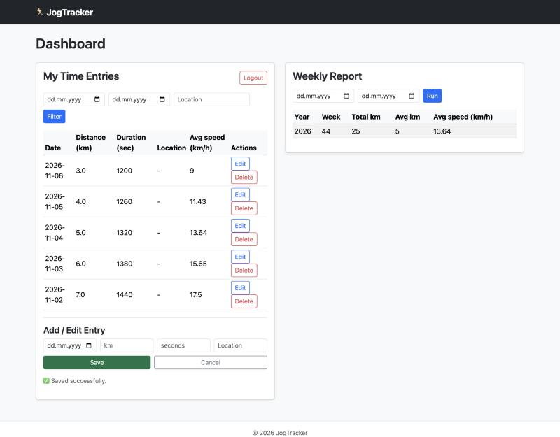
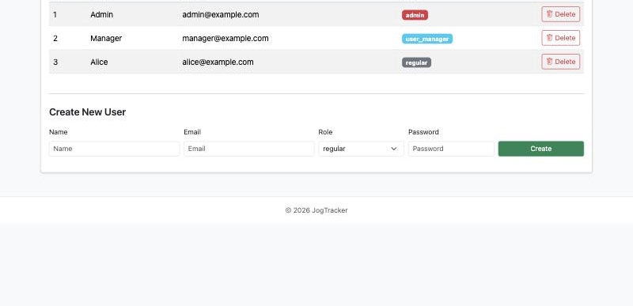

# JogTracker

JogTracker is a Ruby on Rails app for recording jogging sessions and tracking weekly progress. It has a JSON API, a Bootstrap dashboard and role-based access for regular users, user managers and admins.

## Features

- Register, log in and log out with API tokens
- Create, edit and delete jogging entries, and filter them by date or location
- See average speed for each entry
- View weekly distance and speed reports
- Manage users from an admin page
- Control access with three user roles

## Screenshots





## Tech stack

- Ruby 3.2.2 and Rails 7.1
- SQLite
- Bootstrap 5 and vanilla JavaScript
- bcrypt for password hashing
- Active Model Serializers for JSON responses
- Minitest for tests

## Getting started

You need Ruby 3.2.2 and Bundler.

```bash
git clone https://github.com/oefr234/jogytracker.git
cd jogytracker
bundle install
bin/rails db:prepare
bin/rails db:seed
bin/rails server
```

Open <http://localhost:3000/login>.

The seed data is for local development only. Every demo account uses the password `password`:

| Role | Email |
| --- | --- |
| Admin | `admin@example.com` |
| User manager | `manager@example.com` |
| Regular user | `alice@example.com` |

## Running the tests

```bash
bin/rails test
```

The integration tests in `test/integration/api_authorization_test.rb` check what each role can access.

## Roles

| Action | Regular user | User manager | Admin |
| --- | --- | --- | --- |
| Manage own entries | Yes | Yes | Yes |
| Change other users' entries | No | Yes | Yes |
| List and create users | No | Yes | Yes |
| Create or assign admins | No | No | Yes |
| Change or delete admin accounts | No | No | Yes |

Users cannot delete their own account.

## API

Send the token returned by login or registration with each protected request:

```text
Authorization: Token token=YOUR_TOKEN
```

| Method | Path | Description |
| --- | --- | --- |
| `POST` | `/api/register` | Create a regular user |
| `POST` | `/api/login` | Log in and receive a token |
| `DELETE` | `/api/logout` | Revoke the current token |
| `GET` | `/api/time_entries` | List entries, with optional `from`, `to`, `location` and `user_id` filters |
| `POST` | `/api/time_entries` | Create an entry |
| `GET` | `/api/time_entries/:id` | Show an entry |
| `PATCH` | `/api/time_entries/:id` | Update an entry |
| `DELETE` | `/api/time_entries/:id` | Delete an entry |
| `GET` | `/api/reports/weekly` | Show weekly totals and averages |
| `GET` | `/api/users` | List users |
| `POST` | `/api/users` | Create a user |
| `GET` | `/api/users/:id` | Show a user |
| `PATCH` | `/api/users/:id` | Update a user |
| `DELETE` | `/api/users/:id` | Delete a user |

Log in:

```bash
curl -X POST http://localhost:3000/api/login \
  -H "Content-Type: application/json" \
  -d '{"email":"alice@example.com","password":"password"}'
```

Create an entry:

```bash
curl -X POST http://localhost:3000/api/time_entries \
  -H "Authorization: Token token=YOUR_TOKEN" \
  -H "Content-Type: application/json" \
  -d '{"time_entry":{"date":"2026-11-06","distance_km":5.2,"duration_seconds":1800,"location":"Cluj-Napoca"}}'
```
